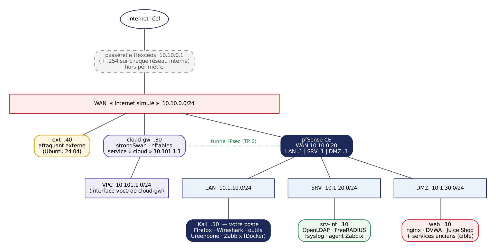

# Avant de commencer

Ce dépôt réunit les énoncés des travaux pratiques de la formation **3-020 « Sécurisation des architectures réseaux »**. Lisez chaque énoncé ici, sur GitHub, dans Firefox sur votre Kali : chaque bloc de commandes a un bouton de copie en haut à droite. Les notions sont développées dans le support de cours.

> **Rappel du cadre.** Toutes les manipulations se déroulent **exclusivement** dans votre laboratoire individuel. Ne ciblez jamais l'environnement d'un autre apprenant, l'infrastructure de la plateforme ou un système extérieur. Les techniques offensives utilisées ici sont, hors de ce cadre, pénalement répréhensibles (art. 323-1 et suivants du Code pénal).

## Votre laboratoire

Chaque apprenant dispose de **6 machines virtuelles** sur la plateforme Hexceos, qu'il ouvre depuis **son portail personnel** : un clic sur une machine ouvre sa console. Aucun laboratoire ne communique avec un autre : les adresses sont donc **les mêmes pour tout le monde**.

| Bouton du portail | Usage |
| --- | --- |
| Ouvrir la console | Écran de la machine, comme si vous étiez devant |
| Marche/arrêt | Redémarrer une machine bloquée |
| Appareil photo | **Instantané** : sauvegarder l'état d'une machine, ou y revenir |
| Clé | Identifiants de la machine |

**La Kali est votre poste de travail.** Elle est branchée sur le LAN du laboratoire avec l'adresse `10.1.10.10`, derrière pfSense, comme le poste d'un administrateur. Vous y trouvez Firefox (pfSense, Greenbone, Zabbix, DVWA…), Wireshark, un terminal et les outils d'analyse (`nmap`, `arpwatch`, `tcpdump`, `testssl.sh`, `ssh-audit`, `ldapsearch`, `radtest`…). Depuis le terminal, vous joignez les autres machines **en SSH** avec le compte `formation`, comme sur un vrai réseau : chaque connexion traverse pfSense et ses règles.

## Topologie

| Machine | Rôle | Adresse(s) | Accès depuis la Kali |
| --- | --- | --- | --- |
| **Kali** (votre poste) | Poste d'administration : Firefox, Wireshark, outils ; héberge Greenbone et Zabbix | 10.1.10.10 (LAN) | Console du portail |
| pfSense | Pare-feu, routeur, IDS/IPS, VPN | WAN 10.10.0.20 · LAN 10.1.10.1 · SRV 10.1.20.1 · DMZ 10.1.30.1 | https://10.1.10.1 |
| srv-int | OpenLDAP, FreeRADIUS, collecteur rsyslog, agent Zabbix | 10.1.20.10 (SRV) | `ssh formation@10.1.20.10` |
| web | nginx, DVWA, Juice Shop et services anciens (cible vulnérable) | 10.1.30.10 (DMZ) | `ssh formation@10.1.30.10` ; http(s)://10.1.30.10 |
| cloud-gw | Passerelle du « cloud » (strongSwan, nftables) et service applicatif « cloud » | 10.10.0.30 (WAN) · 10.101.1.1 (VPC) | `ssh formation@10.10.0.30` |
| ext | Machine « Internet » : attaquant externe, tests d'exposition | 10.10.0.40 (WAN) | `ssh formation@10.10.0.40` |

Le réseau WAN `10.10.0.0/24` joue **Internet**. Sa passerelle, `10.10.0.1`, appartient à la plateforme Hexceos et donne accès au vrai Internet. La plateforme a aussi une adresse en `.254` sur chacun de vos réseaux internes. Ces équipements sont **hors du périmètre** de vos tests : ne les balayez pas, ne les attaquez pas.

**Identifiants et fichiers.** Les identifiants des services du lab (Greenbone, LDAP, FTP…) sont dans `~/TP/identifiants-lab.txt` sur la Kali ; ceux des machines et de pfSense sont dans le portail (bouton clé). Vous changerez plusieurs mots de passe au fil des TP. Les fichiers de TP (captures, mandat d'audit) sont dans `~/TP` ; ils sont aussi dans ce dépôt, dans [`fichiers/`](fichiers).

**Captures.** Il n'y a pas de port miroir dans ce laboratoire. Pour observer un trafic, capturez là où il passe :
- sur la **Kali** (`eth1`), pour tout ce qu'elle envoie ou reçoit, avec Wireshark ;
- sur une **machine Linux**, avec `sudo tcpdump -ni ens18 -w /tmp/capture.pcap`, puis rapatriez le fichier sur la Kali avec `scp` pour l'ouvrir dans Wireshark ;
- sur **pfSense**, avec *Diagnostics → Packet Capture* : choisissez l'interface, lancez, puis téléchargez le fichier.

## Deux règles à respecter

- **Ne rallumez pas la carte `eth0` de la Kali**, et ne modifiez pas les routes des machines (sauf consigne explicite d'un TP). Le réseau de la plateforme sait router entre vos zones : une route modifiée ferait passer le trafic **à côté** de pfSense, et vos tests de filtrage ne voudraient plus rien dire.
- **Le compte `formation`** a les droits `sudo` sur toutes les machines Linux : utilisez-les pour les manipulations demandées, pas pour contourner un exercice.

## Habitudes à prendre

- **Un instantané avant chaque TP** qui modifie la configuration, au moins de pfSense et des machines touchées (bouton appareil photo du portail). En cas de fausse manœuvre, revenir à l'instantané prend une minute ; mieux vaut restaurer que perdre vingt minutes.
- **Deux terminaux** : l'un pour agir, l'autre pour observer (`tcpdump`, journaux, `arpwatch`).
- **Copier-coller** : le plus simple est d'ouvrir l'énoncé sur GitHub dans Firefox, **sur la Kali**, et d'utiliser le bouton de copie des blocs de code.
- **Garder vos livrables** : chaque TP produit un livrable (cartographie, matrice, rapport…). Rangez-les dans `~/livrables` sur la Kali et récupérez-les chaque soir : les machines sont détruites après la formation.
- **Avant de chercher longtemps** : consultez [En cas de blocage](en-cas-de-blocage.md), puis appelez le formateur.

---

[Sommaire](README.md) · [TP1 →](tp1/README.md)
